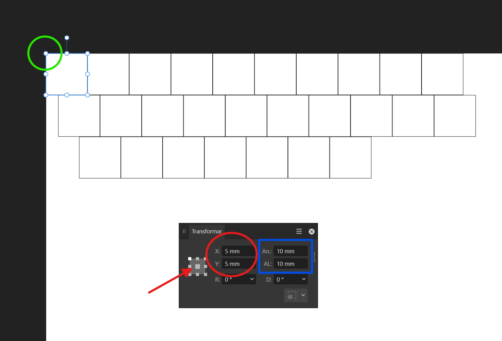
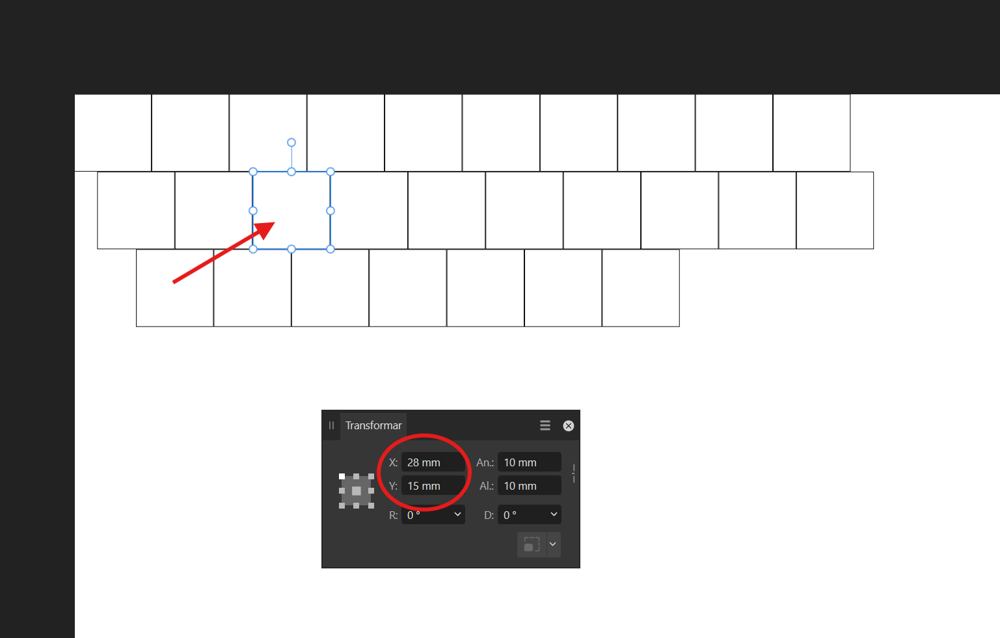
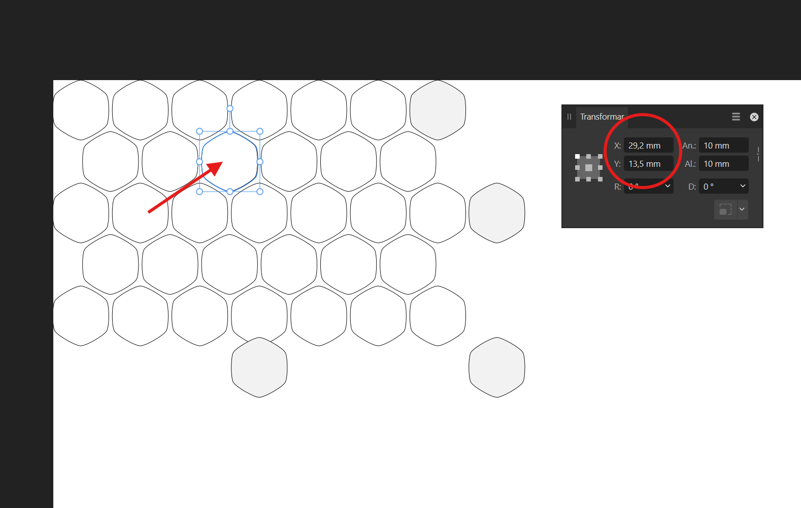
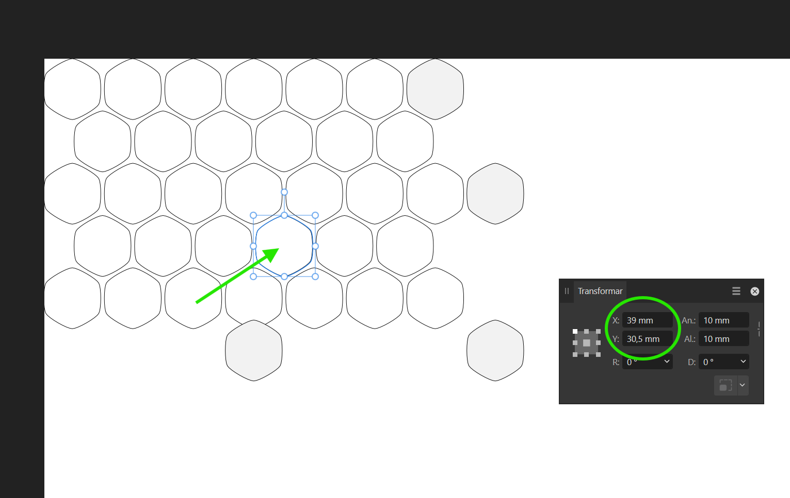

# Letter Metter — Eye Sense vs. QWERTY

[](https://github.com/polrubiano/letter-metter/actions/workflows/ci.yml)


> Analysis tool built to validate the keyboard I designed for [**Eye Sense**](https://github.com/polrubiano/eyesense), an eye-tracking communication app for people with reduced mobility.

A Python tool that **measures and compares how far the eyes have to travel to type a text** on a
traditional QWERTY keyboard and on **Eye Sense**, a hexagonal on-screen keyboard designed for people
with reduced mobility who type with eye-tracking.

From that distance and the user's current typing speed, it estimates their speed on Eye Sense and
how much time they would save.

```console
$ letter-metter texts/don_quijote.txt --kpm 15
File processed: texts/don_quijote.txt
Valid keystrokes: 776819
Scale applied -> Eye Sense Keyboard: 1x | QWERTY: 1x

---------------------------------------------
Distance QWERTY:             28.415 km
Distance Eye Sense Keyboard: 14.337 km
---------------------------------------------
Saved distance: 14.078 km (49.5% less movement)

Time on QWERTY:             863 h 7 min     -> Baseline of 15.0 KPM (4.0 sec/keystroke)
Time on Eye Sense Keyboard: 435 h 30 min    -> Extrapolated to 29.7 KPM (2.0 sec/keystroke)
Total time saved:           427 h 37 min
```

## Why

For a user who types by looking at each key, every millimetre between two letters costs time and
fatigue. Eye Sense reduces that distance in two ways:

1. **Hexagonal tiling.** Every key keeps a 10 × 10 mm footprint, the same as a QWERTY key, but
   hexagons nest into each other. The centres of neighbouring keys end up 10 mm apart horizontally
   and 8.66 mm vertically, so the whole keyboard is more compact without making any key smaller.
2. **Letter arrangement.** The most frequent Spanish letters (`e a o s r n l d ...`) are grouped
   in the middle of the keyboard, so the eyes rarely have to travel to the edges.

Letter Metter turns those design decisions into a number you can check.

## Erratum: key width in the original Eye Sense layout

The original Eye Sense layout (`--layout eye-sense`) carried over a measuring error from the design
tool. The hexagonal keys have rounded corners, and the 10 mm bounding box around each one was
fitted to the **sharp vertices** of the hexagon instead of the **rounded edge**. The rounded edge is
what actually gives a key its 10 mm width. As a result, the keys were narrower than 10 mm. Their
centres ended up 9.8 mm apart horizontally and 8.5 mm vertically, instead of 10 mm and 8.66 mm.

Smaller keys mean shorter distances, so the original layout was compared against QWERTY at a
slight advantage. Its results were slightly optimistic.

The **Eye Sense Keyboard** layout (`--layout eye-sense-keyboard`, now the default) uses the correct
geometry: every key is a true 10 mm wide, the same as a QWERTY key. It also rearranges the letters.
On the full *Don Quijote* at 15 KPM:

| Layout | Distance | Less movement than QWERTY | Estimated KPM |
| --- | --- | --- | --- |
| Eye Sense (original, error included) | 13.320 km | 53.1 % | 32.0 |
| Eye Sense, same letters on the corrected grid | 13.584 km | 52.2 % | 31.4 |
| **Eye Sense Keyboard** (corrected) | **14.337 km** | **49.5 %** | **29.7** |

The error alone accounts for about one percentage point (53.1 % → 52.2 %). The rest of the
difference comes from the new letter arrangement. The original layout is kept for reference and to
reproduce earlier results.

> **Work in progress:** the letter positions in Eye Sense Keyboard are not final. As was done with
> the original layout, the arrangement will be iterated on to improve these results. Expect the
> figures above to change.

## Quick start

Requires Python 3.10+. No runtime dependencies.

```bash
git clone https://github.com/polrubiano/letter-metter.git
cd letter-metter
python -m venv .venv && source .venv/bin/activate   # Windows: .venv\Scripts\activate
pip install -e .

letter-metter texts/sample.txt --kpm 15
# or, equivalently:
python -m letter_metter texts/sample.txt --kpm 15
```

Every new terminal needs the virtual environment activated again before running the command.

### Running from an IDE (PyCharm)

Create a **Run/Debug configuration** of type *Python*:

- **Module name:** `letter_metter` (or **Script path:** `letter_metter/__main__.py`)
- **Parameters:** `texts/don_quijote.txt --kpm 15`
- **Working directory:** the project root
- **Interpreter:** the project's `.venv`

| Option | Default | Meaning |
| --- | --- | --- |
| `TEXT_FILE` | — | UTF-8 text to analyse |
| `--kpm` | `15` | User's current **keystrokes per minute** on QWERTY (15 KPM = 4 s per key) |
| `--layout` | `eye-sense-keyboard` | Layout to compare against QWERTY: `eye-sense-keyboard` or `eye-sense` |
| `--eye-scale` | `1.0` | Size multiplier of the compared layout (`1.5` = keys 50 % larger) |
| `--qwerty-scale` | `1.0` | Size multiplier of the QWERTY keyboard |

It can also be used as a library:

```python
from letter_metter import compare

result = compare("En un lugar de la Mancha...", kpm=15)
print(result.saved_distance_pct, result.kpm_eye)
```

## How it works

1. **Normalise the text.** Lowercase it and strip accents (`á → a`, `ü → u`) while keeping `ñ`.
   Spaces, digits and punctuation are ignored. In the Eye Sense app, word prediction handles most of
   those keys, so the letters carry the cost.
2. **Measure the path.** For each pair of consecutive letters, add up the Euclidean distance between
   the centres of their keys:
   `d = Σ √((x₂ − x₁)² + (y₂ − y₁)²) × scale`
3. **Calibrate the user.** From their current KPM on QWERTY, work out how many millimetres per second
   their eyes travel: `speed = d_qwerty / t_qwerty`.
4. **Extrapolate.** Apply that same speed to the Eye Sense path. This simplifies to
   `KPM_eye = KPM_qwerty × d_qwerty / d_eye`.

### Code layout

```
letter_metter/
├── layouts.py     # Layout dataclass + EYE_SENSE and QWERTY_ES coordinates
├── text.py        # clean_text, extract_keystrokes
├── metrics.py     # path_distance, compare -> ComparisonResult
├── formatting.py  # format_distance, format_time
└── cli.py         # command-line interface
tests/             # pytest suite, including a regression test on the full Don Quijote
```

## Defining a keyboard layout

A layout is just a map from each letter to the **centre of its key, in millimetres**:

- every key fits in a **10 × 10 mm** bounding box;
- the origin **(0, 0)** is the **top-left corner** of the keyboard, with Y growing downwards.

Any vector design tool gives you these numbers directly. Select a key, set the reference point to
its centre, and read X/Y:



- Green circle: the origin (0, 0).
- Arrow: the reference point of the selected shape (its centre).
- Red circle: the coordinates of that point, here x = 5, y = 5 (the key is 10 × 10 mm, blue box).



The same process on the hexagonal Eye Sense grid:





Then add it in code:

```python
from letter_metter import Layout

MY_LAYOUT = Layout("My layout", {"a": (5, 5), "b": (15, 5), ...})
```

To make it selectable with `--layout`, register it in `LAYOUTS` (in `layouts.py`) under a
command-line name, e.g. `"my-layout": MY_LAYOUT`.

Both layouts in a comparison must contain the same letters.

<details>
<summary><b>QWERTY (Spanish) coordinates</b></summary>

Rows are staggered by 0, 3 and 8 mm, as on a physical keyboard.

| Row | Keys (x, y in mm) |
| --- | --- |
| 1 | q (5, 5) · w (15, 5) · e (25, 5) · r (35, 5) · t (45, 5) · y (55, 5) · u (65, 5) · i (75, 5) · o (85, 5) · p (95, 5) |
| 2 | a (8, 15) · s (18, 15) · d (28, 15) · f (38, 15) · g (48, 15) · h (58, 15) · j (68, 15) · k (78, 15) · l (88, 15) · ñ (98, 15) |
| 3 | z (13, 25) · x (23, 25) · c (33, 25) · v (43, 25) · b (53, 25) · n (63, 25) · m (73, 25) |

</details>

<details>
<summary><b>Eye Sense (original) coordinates</b>, including the key-width error described in the <a href="#erratum-key-width-in-the-original-eye-sense-layout">erratum</a></summary>

| Row | Keys (x, y in mm) |
| --- | --- |
| 1 | f (9.6, 5) · m (19.4, 5) · t (29.2, 5) · b (39, 5) · q (48.8, 5) |
| 2 | z (4.7, 13.5) · i (14.5, 13.5) · d (24.3, 13.5) · s (34.1, 13.5) · u (43.9, 13.5) · j (53.7, 13.5) · w (63.6, 13.5) |
| 3 | l (9.6, 22) · a (19.4, 22) · e (29.2, 22) · o (39, 22) · g (48.8, 22) · x (58.7, 22) |
| 4 | h (4.7, 30.5) · c (14.5, 30.5) · r (24.3, 30.5) · n (34.1, 30.5) · p (43.9, 30.5) · y (53.7, 30.5) · k (63.6, 30.5) |
| 5 | v (9.6, 39) · ñ (58.7, 39) |

</details>

### Scaling factor

Physical prototypes are often printed at a different size. Instead of rewriting the coordinates,
pass a multiplier. With `--eye-scale 1.5`, 10 mm keys become 15 mm. The two scales are independent,
so you can compare keyboards of different sizes.

## Limitations

The model is a **theoretical best case**. It is useful for comparing layouts, but it is not a
prediction of real-world speed:

- **Time is proportional to distance.** It does not account for dwell time (how long the user looks
  at a key to select it), visual search, or the effect of target size
  ([Fitts's law](https://en.wikipedia.org/wiki/Fitts%27s_law)).
- **Straight lines.** The eyes are assumed to move in a straight line from centre to centre.
- **Letters only.** Space, punctuation and other function keys are not counted.
- **No starting position.** The path starts at the first letter of the text.

## Development

```bash
pip install -e ".[dev]"
pytest           # unit, CLI and regression tests
ruff check .     # lint
ruff format .    # format
```

## Related

- [Eye Sense](https://github.com/polrubiano/eyesense): project overview and my contribution (keyboard design and development). The app's source code is currently private.

## License

[MIT](LICENSE). `texts/don_quijote.txt` and `texts/sample.txt` are in the public domain.